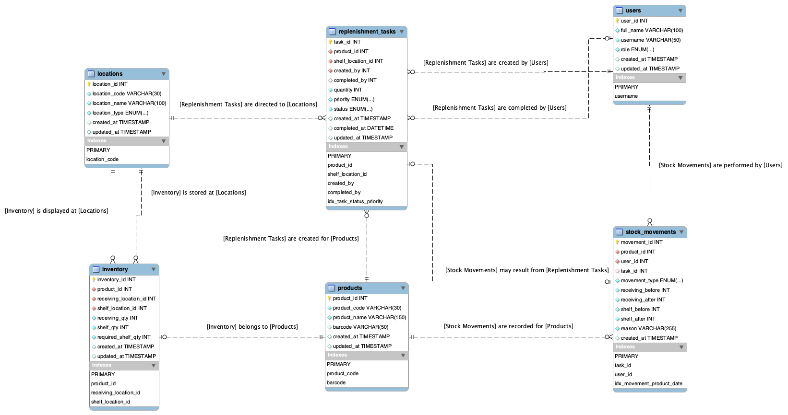

## REST API Documentation

The Pick n Pay Receiving Stock System uses a REST API developed
with Flask to communicate between the web application and the
MySQL database.

The API returns information in JSON format and supports the
creation, retrieval and updating of products, inventory records
and replenishment tasks.

### Base URL

http://127.0.0.1:5001

### API Endpoints

| Method | Endpoint | Description | Success Status |
|---|---|---|---|
| GET | /api/products | Retrieve all products and inventory information | 200 |
| GET | /api/products/<id> | Retrieve a specific product | 200 |
| POST | /api/products | Create a new product and inventory record | 201 |
| PATCH | /api/products/<id> | Update existing product information | 200 |
| GET | /api/tasks | Retrieve replenishment tasks | 200 |
| GET | /api/tasks/<id> | Retrieve a specific replenishment task | 200 |
| POST | /api/tasks | Dispatch a new replenishment task | 201 |
| PATCH | /api/tasks/<id> | Complete a replenishment task | 200 |
| PATCH | /api/inventory/<id> | Process an inventory transaction | 200 |
| GET | /api/stock-movements | Retrieve stock movement history | 200 |
| GET | /api/users | Retrieve system users | 200 |
| GET | /api/locations | Retrieve shelf and receiving locations | 200 |
| GET | /api/dashboard | Retrieve inventory and performance KPIs | 200 |

### Pagination and Filtering

The products endpoint supports optional pagination and filtering
through query parameters.

| Parameter | Purpose | Example |
|---|---|---|
| page | Select the page number | page=1 |
| size | Specify the number of records per page | size=10 |
| search | Search by name, product code or barcode | search=milk |
| status | Filter according to stock availability | status=insufficient |

Examples:

- `/api/products?page=1&size=10`
- `/api/products?page=2&size=10`
- `/api/products?search=milk`
- `/api/products?status=sufficient`
- `/api/products?status=insufficient`
- `/api/products?status=out_of_stock`

Valid page sizes range from 1 to 100.

If pagination parameters are not provided, the API returns all
matching products.

The tasks endpoint supports filtering by status and priority:

- `/api/tasks?status=pending`
- `/api/tasks?status=completed`
- `/api/tasks?priority=high`

The locations endpoint supports filtering by location type:

- `/api/locations?type=shelf`
- `/api/locations?type=receiving`

### Example JSON Requests and Responses

#### Retrieve an Individual Product

GET /api/products/1

Example response:

```json
{
    "product_id": 1,
    "product_code": "PRD-001",
    "product_name": "PnP Full Cream Milk 2L",
    "barcode": null,
    "shelf_qty": 5,
    "required_shelf_qty": 25,
    "receiving_qty": 20,
    "quantity_needed": 20,
    "shelf_location_id": 1,
    "receiving_location_id": 41,
    "shelf_location": "Aisle 1, Shelf 1",
    "receiving_location": "Receiving - Refrigerated Dairy"
}
```

#### Create a Product

POST /api/products

Request:

```json
{
    "product_code": "PRD-031",
    "product_name": "PnP Orange Juice 1L",
    "receiving_location_id": 43,
    "shelf_location_id": 9,
    "required_shelf_qty": 25
}
```

Response:

```json
{
    "message": "Product created successfully.",
    "product_id": 31
}
```

#### Update a Product

PATCH /api/products/31

Request:

```json
{
    "product_name": "PnP Orange Juice 2L"
}
```

Response:

```json
{
    "message": "Product updated successfully.",
    "product_id": 31
}
```

#### Dispatch a Replenishment Task

POST /api/tasks

Request:

```json
{
    "product_id": 1,
    "quantity": 20,
    "priority": "High",
    "username": "alex"
}
```

Response:

```json
{
    "message": "Replenishment task created.",
    "task_id": 5
}
```

#### Complete a Replenishment Task

PATCH /api/tasks/5

Request:

```json
{
    "username": "jamie"
}
```

Response:

```json
{
    "message": "Replenishment task completed.",
    "receiving_qty": 0,
    "shelf_qty": 25
}
```

#### Receive Supplier Stock

PATCH /api/inventory/1

Request:

```json
{
    "action": "receive",
    "quantity": 30,
    "username": "jordan",
    "reason": "Supplier delivery received."
}
```

The inventory endpoint supports four transaction types:

- receive
- damage
- reconcile
- shelf

A stock movement record is created for every successful
inventory transaction.

### GET Response Structures

| Endpoint | JSON response |
|---|---|
| /api/products | Array of product and inventory objects |
| /api/products/<id> | Individual product and inventory object |
| /api/tasks | Array of replenishment task objects |
| /api/tasks/<id> | Individual replenishment task object |
| /api/users | Array of user objects containing ID, name, username and role |
| /api/locations | Array of location objects containing ID, code, name and type |
| /api/stock-movements | Array of stock movement objects containing before-and-after quantities, user, reason and timestamp |
| /api/dashboard | Object containing calculated inventory and performance metrics |

The example IDs and quantities represent sample data and may
differ after inventory transactions have been performed.

### HTTP Status Codes

| Code | Meaning |
|---|---|
| 200 | Request completed successfully |
| 201 | Record created successfully |
| 400 | Invalid request or input |
| 404 | Requested resource not found |
| 405 | HTTP method not allowed |
| 500 | Internal server or database error |

Example error response:

```json
{
    "error": "Product not found."
}
```

### Input Validation

The backend validates incoming requests to maintain inventory
accuracy and database integrity.

Validation includes:

- Required fields and valid data types.
- Unique product codes and barcodes.
- Positive replenishment quantities.
- Non-negative inventory quantities.
- Valid shelf and receiving locations.
- Prevention of duplicate pending replenishment tasks.
- Prevention of replenishment beyond available receiving stock.
- Prevention of replenishment beyond shelf requirements.
- Valid pagination and filtering parameters.

### Error Handling and Logging

Centralised error handlers return consistent JSON error
responses.

Python logging records application events, invalid requests
and database errors.

SQL queries use parameterised values. Database transactions
are used when multiple related records must be updated
together. Uncommitted changes are rolled back if an operation
fails.

### Flask Blueprint Structure

The application separates its API routes from the main
Flask application using a Blueprint.

| File | Responsibility |
|---|---|
| app.py | Application startup and Blueprint registration |
| routes/api.py | REST API endpoints, validation and error handling |
| routes/__init__.py | Python package initialisation |
| config.py | Environment-specific configuration |
| db.py | MySQL connection management |
| templates/index.html | Web application interface |

### Application Environments

The application supports three configuration environments:

| Environment | Purpose |
|---|---|
| Development | Local development and debugging |
| Testing | Testing against a separate database |
| Production | Normal operation with debugging disabled |

Configuration settings are loaded from environment variables.

The `.env.example` file provides the required configuration
variables without exposing actual database credentials.

The current application uses a local user-selection feature
for demonstration purposes. This is not password-based
authentication.

### API Testing

The registered endpoints can be inspected by running:

```bash
python -m flask --app app routes
```

API endpoints can be tested through a browser, PowerShell,
Postman or the Flask test client.

## Supply Chain Model Integration

The Economic Order Quantity (EOQ) model is integrated
into the Inventory Control section of the web application.

The system retrieves the selected product from MySQL
and calculates its recommended supplier order quantity
using the functions defined in EOQ.py.

API endpoint:

GET /api/products/<id>/eoq

The model calculates:

- Economic order quantity
- Orders per year
- Days between orders
- Total annual inventory cost

The model assists supplier ordering decisions without
automatically increasing receiving inventory.

Demand and cost inputs are estimated for demonstration
purposes to protect confidential store information.

Actual ordering decisions must also consider shelf life,
storage capacity and supplier constraints.

## Installation and Application Setup

### System Requirements

The following software is required to run the application:

- Python 3.12
- MySQL Server 8.0 or later
- MySQL Workbench
- Git
- A web browser

Visual Studio Code is recommended for development.

### Step 1: Clone the Repository

```bash
git clone https://github.com/u23561612-png/Semester-Project-Group-22.git
cd Semester-Project-Group-22
```

### Step 2: Install Python Dependencies

On macOS:

```bash
python3 -m pip install -r requirements.txt
```

On Windows:

```powershell
py -m pip install -r requirements.txt
```

### Step 3: Configure the MySQL Database

1. Start MySQL Server.
2. Open MySQL Workbench.
3. Connect to the local MySQL server.
4. Open and execute schema.sql.
5. Open and execute seed.sql.

The schema script creates the pnp_receiving database
and its six related tables.

The seed script populates the database with sample
products, users, inventory records, locations,
replenishment tasks and stock movements.

These scripts should only be executed on a fresh
database to avoid duplicate sample records.

### Step 4: Configure Environment Variables

Create a file named .env in the main project folder.

Use .env.example as a template.

```env
DB_HOST=127.0.0.1
DB_PORT=3306
DB_USER=your_database_username
DB_PASSWORD=your_database_password
DB_NAME=pnp_receiving
APP_ENV=development
DB_TEST_NAME=pnp_receiving_test
```

Replace the username and password with the local
MySQL connection details.

The .env file is excluded from version control
to protect database credentials.

### Step 5: Test the Database Connection

On macOS:

```bash
python3 test_db.py
```

On Windows:

```powershell
py test_db.py
```

Expected result for a fresh database:

Successfully connected to MySQL!
Database: pnp_receiving
Total products: 30

### Step 6: Start the Application

On macOS:

```bash
python3 app.py
```

On Windows:

```powershell
py app.py
```

Open the following URL in a web browser:

http://127.0.0.1:5001

Keep the terminal running while using the application.

### Demonstration Users

| User | Role |
|---|---|
| Sam | Store Manager |
| Alex | Floor Manager |
| Jamie | Staff Member |
| Jordan | Receiving Manager |

Users can be selected from the Users tab or by
clicking the user profile in the top-right corner.

The current prototype uses user selection rather
than password-based authentication.

### Deployment Approach

The application is deployed locally using Flask
and MySQL. It supports Windows and macOS.

The local development server is intended for
demonstration and testing purposes.

A production deployment would require a production
WSGI server, secure hosting and authentication.

### Entity Relationship Diagram


